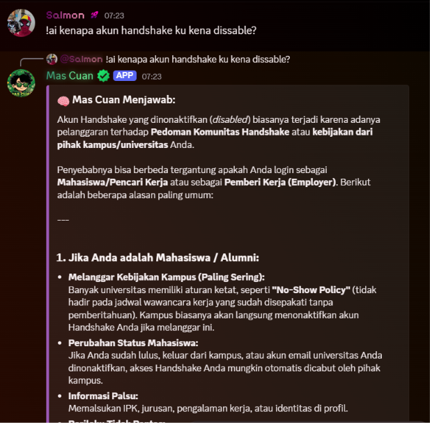
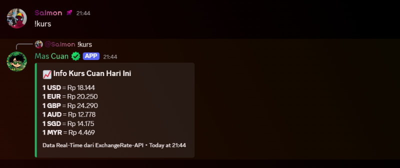
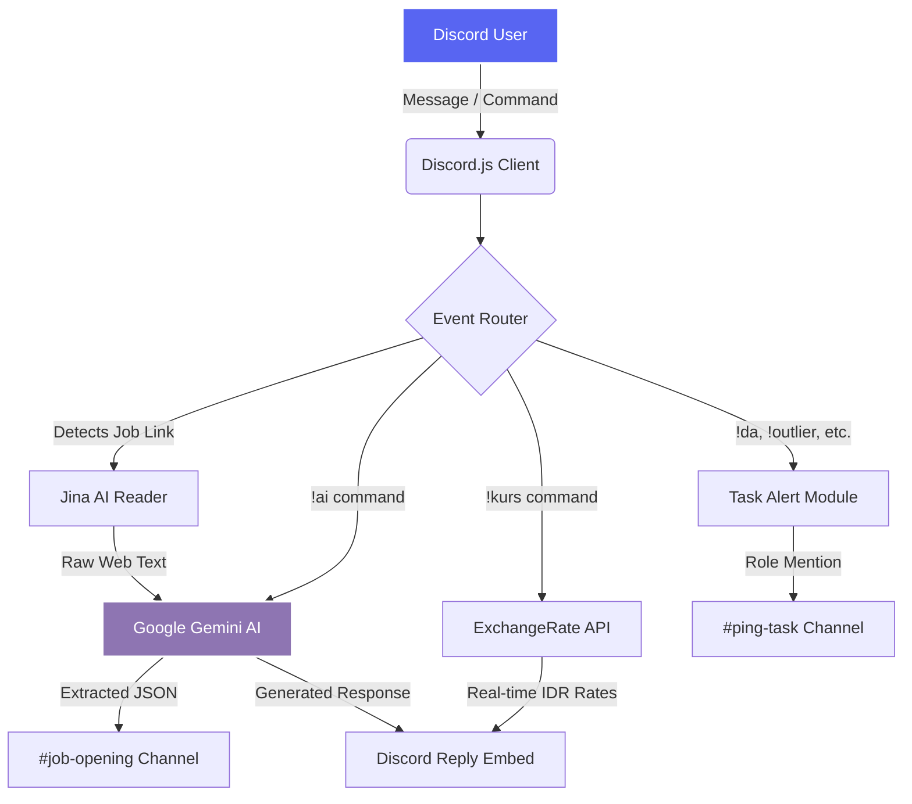

# 💸 Mas Cuan - AI Discord Assistant for Freelancers

<div align="center">
  
  
  
  
</div>

<br>

**Mas Cuan** is a highly specialized, AI-powered Discord Bot designed for AI Trainers, RLHF Specialists, and remote Freelancers. It streamlines community management by automating job posting evaluations, providing real-time AI assistance, calculating multi-currency exchange rates, and managing task drop alerts.

---

## 📸 Showcase

> 🖼️ **AI Assistant in Action**
> <br>
> 
> 
> 🖼️ **Auto Check Kurs**
> <br>
> 

---

## 🏗️ System Architecture

The bot leverages a modern event-driven architecture, processing Discord messages through a central router that delegates tasks to external APIs and LLMs.



---

## ⌨️ Commands Reference

| Command | Arguments | Example | Description |
| :--- | :--- | :--- | :--- |
| `!ai` | `[prompt]` | `!ai what is RLHF?` | Prompts Google Gemini 3.8 Flash for a direct response. |
| `!kurs` | `[amount]` (optional) | `!kurs 15.5` | Converts USD, EUR, GBP, AUD, SGD, and MYR to IDR. |
| `!info` | `[announcement]` | `!info Server update!`| Broadcasts an admin announcement to the `#information` channel. |
| `!da` / `!outlier` | `[task details]` | `!da coding tasks up!`| Pings specific community roles when new tasks drop. |
| `!help` | *None* | `!help` | Displays the bot's usage guide and available features. |

---

## ✨ Core Features

* **🤖 Auto-Filter Job Postings (RAG System):** Detects URLs in the discussion channel, scrapes web content using Jina AI, and utilizes Gemini AI to extract Company, Role, and Salary details into a formatted embed.
* **🧠 Direct AI Assistant:** Powered by `@google/genai` to help freelancers fix grammar, brainstorm prompts, or answer technical coding queries directly inside Discord.
* **💱 Multi-Currency Converter:** Instant real-time conversion for global freelancers earning in USD, EUR, GBP, AUD, SGD, and MYR.
* **🚨 Task Drop Alerts:** Role-based ping system to ensure members never miss limited freelance task quotas from platforms like Outlier, DataAnnotation, and Mercor.

---

## 🚀 Getting Started

### 1. Prerequisites
* Node.js v18.0.0 or higher.
* A Discord Bot Token ([Discord Developer Portal](https://discord.com/developers/applications)).
* A Google Gemini API Key ([Google AI Studio](https://aistudio.google.com/)).

### 2. Installation
Clone the repository and install dependencies:
```bash
git clone https://github.com/aldibae/discord-bot-mas-cuan.git
cd discord-bot-mas-cuan
npm install
```

### 3. Configuration
Open `index.js` and fill in your credentials and Discord channel IDs in the configuration section:

| Variable | Description |
| :--- | :--- |
| `BOT_TOKEN` | Your application's secret token from Discord. |
| `GEMINI_API_KEY` | Your API key for accessing Google's Gemini Models. |
| `SUBMIT_CHANNEL_ID` | Channel ID where users drop job links. |
| `TARGET_CHANNEL_ID` | Channel ID where verified jobs are posted. |

### 4. Run the Bot
```bash
# Run locally
node index.js
```

---

## 👤 Author

**Aldi Anugrah**
* 💼 **Portfolio:** [aldianugrah.com]
* 🔗 **LinkedIn:** [linkedin.com/in/aanugrah]

*Built with ❤️ for the AI Trainer & Freelancer Community.*